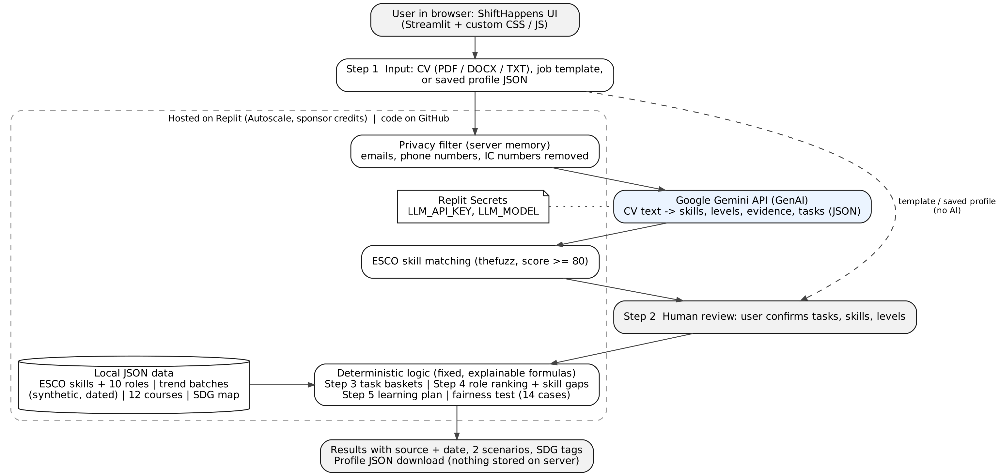

# ShiftHappens

> AI changes tasks, not whole jobs. ShiftHappens shows Malaysian office workers which of their daily tasks AI may take over, assist, or leave to humans, matches them to future roles, and builds a free or low-cost learning plan.

---

## Team Information

| Field                  | Details                                                        |
| ---------------------- | -------------------------------------------------------------- |
| **Team Name**          | 16.0                                                           |
| **Team Domain**        | Aiversecity - Future-Ready Workforce                           |
| **SDG Track (1-17)**   | SDG 4 - Quality Education (related: SDG 8 - Decent Work and Economic Growth) |
| **Team Leader**        | Wong Pynven                                                    |
| **University**         | University Malaya                                              |
| **Number of Members**  | 5                                                              |

## Links

| Resource          | Link                                                         |
| ----------------- | ------------------------------------------------------------ |
| GitHub Repository | https://github.com/jenwennnn/SDC_Hackathon_2026_Team16.0      |
| Live Demo         | https://sdc-hackathon-2026-team-160.replit.app                |
| RunPod Endpoint   | Not used (see "How We Use RunPod")                           |
| Slide Deck        | https://drive.google.com/file/d/1pBJWAZ9RGUueGuC-FQxS4r90HlZzxUzc/view?usp=sharing                                                  |
| Demo Video        | https://youtu.be/Qd4ovTAmQ44                                                  |

---

## Overview

### Problem

TalentCorp's 2024 impact study estimates that about 620,000 jobs - 18% of 3.5 million employees in ten key Malaysian sectors - are highly impacted by AI, digitalisation and the green economy within three to five years. Mid-career office workers in routine-heavy roles (admin, data entry, customer service, accounting support, content and marketing) hear that "AI will take your job", but nobody tells them which of their tasks will change, how fast, or what to learn next. They also have little time and money, and they do not trust black-box AI advice with their CV.

### Solution

ShiftHappens breaks a job into its daily tasks and sorts each task into "AI may take over", "AI will assist you" or "stays mostly human", using a dated and updatable trend-signal layer under two scenarios (steady vs rapid AI progress). The same trend data then feeds an explainable ranking of ten future roles from ESCO, with a clear skill gap, and an ordered learning plan of free or low-cost courses that fits the user's hours, budget and timeline.

AI is used in one place only: Google Gemini reads the CV after emails, phone numbers and Malaysian IC numbers are removed. Everything after that uses fixed, explainable formulas, so the system cannot invent jobs or courses, and the user reviews and decides at every step.

### Key Features

- **Skills profile intake** (step 1-2) - upload or paste a CV, pick one of five office-role templates, or re-upload a saved profile; the user reviews every task, skill and level, and sees the AI's evidence and confidence as read-only notes.
- **AI-trend signal layer with source and date** (step 3) - dated data batches (2026-08, 2026-09, 2026-10) with a "what changed" list; switching the batch updates steps 3 to 5 together.
- **Task view: "Your day"** (step 3) - a donut chart and three baskets; every task explains why, the AI impact in both scenarios, market demand, confidence, source and date.
- **Future-role matching** (step 4) - ten ESCO roles ranked by future fit (skill readiness plus market outlook, with a user-controlled weight), essential skills met, skill gaps, SDG tag and the ESCO description.
- **Personalised reskilling pathway** (step 5) - courses in order, with weeks and cost in RM, filtered by budget (free, low cost, HRD Corp claimable) and timeline.
- **SDG mapping** - each role is tagged to an SDG target; the reskilling plan links to SDG 4.4 and 8.5.
- **Handling uncertainty** - Steady vs Rapid AI progress scenarios everywhere, and every result is labelled as an estimate.
- **Fairness check** - the ranking is re-run 14 times with changed personal details (name, age, gender, race, religion, nationality, marital status, disability, contact details and more); results must not change.
- **Privacy** - no accounts, no database; the user downloads their own profile file and can continue later.

### Tech Stack

| Layer         | Technology                                                                 |
| ------------- | -------------------------------------------------------------------------- |
| Frontend      | Streamlit 1.66.1, custom CSS and JavaScript (intro animation, step dock, command palette) |
| Backend       | Python (Streamlit server); pandas, thefuzz, PyPDF2, python-docx            |
| Database      | None by design - data lives in versioned JSON files; no personal data is stored |
| AI / Compute  | Google Gemini API (google-generativeai SDK), used only for CV extraction   |
| Hosting / Dev | Replit Deployments (Autoscale) with Replit Secrets; Git and GitHub          |

---

## Project Structure

```
.
├── app.py                   # Application entry point: steps 1-2, navigation, data controls
├── intro.py                 # Animated opening screen
├── theme.py                 # Global styles
├── fx.py                    # Step dock, command palette, card effects, rolling numbers
├── signals_logic.py         # Trend thresholds, baskets and validation (single source of truth)
├── signals_views.py         # Step 3 "Your day"
├── results_page.py          # Steps 4 "Your roles" and 5 "Your plan"
├── matcher.py               # Role matching and future-fit ranking
├── trend_bridge.py          # Turns trend signals into skill and role outlooks
├── pathway.py               # Learning plan builder
├── fairness.py              # Fairness check (14 cases)
├── generate_signals.py      # Generates the synthetic trend batches
├── build_courses.py         # Builds data/courses.json from courses_input.csv
├── build_skill_task_map.py  # Builds data/skill_task_map.json (keyword rules)
├── add_future_skills_to_seed.py
├── courses_input.csv        # Hand-checked course list (input)
├── data/                    # JSON data used by the app (see "Data Sources")
├── esco/                    # Raw ESCO CSV files (European Commission)
├── outputs/                 # Intermediate files from the data-building scripts
├── scripts/                 # One-off scripts used to build and check the ESCO data
├── docs/                    # Architecture diagram and screenshots
├── submission/              # Required submission documents (PDF)
├── tests/
│   └── test_core.py         # Unit tests for the calculation logic
├── .streamlit/config.toml   # Streamlit theme
├── .env.example             # Example environment variables
├── .gitignore
├── .replit                  # Replit run and deployment configuration
├── LICENSE
├── requirements.txt         # Python dependencies
└── README.md
```

### Architecture



```
User (browser)
   │  CV / job template / saved profile
   ▼
Replit deployment (Streamlit app)
   ├─► Privacy filter: emails, phone numbers, IC numbers removed
   ├─► Google Gemini API: CV text -> skills, levels, evidence, tasks (JSON)
   ├─► ESCO skill matching (fuzzy match, score >= 80)
   ├─► Human review (user confirms tasks, skills, levels)
   ├─► Fixed formulas + local JSON data (ESCO, trend batches, courses, SDG map)
   │      task baskets | role ranking | learning plan | fairness check
   ▼
Results with source, date and scenarios; profile JSON download (nothing stored)
```

---

## How to Run

### Option 1 - Run on Replit (Recommended)

1. Import this repository via **Create Repl -> Import from GitHub**.
2. Open the **Secrets** tab and add the variables listed in `.env.example`:
   - `LLM_API_KEY` - your Google Gemini API key
   - `LLM_MODEL` - the Gemini model name (our deployment uses `gemini-3.8-flash`; the code default is `gemini-2.5-flash`)
3. Click **Run**. Replit uses the `.replit` file to start `streamlit run app.py` on port 8501.

Without an API key the app still runs: CV analysis is turned off, and users can start from a job template or a saved profile.

### Option 2 - Run Locally

```bash
# 1. Clone the repository
git clone https://github.com/jenwennnn/SDC_Hackathon_2026_Team16.0.git
cd SDC_Hackathon_2026_Team16.0

# 2. Create and activate a virtual environment
python -m venv venv
source venv/bin/activate        # Windows: venv\Scripts\activate

# 3. Install dependencies
pip install -r requirements.txt

# 4. Configure environment variables
cp .env.example .env            # Windows: copy .env.example .env  - then fill in your values

# 5. Run the app
streamlit run app.py
```

### Run Tests

```bash
python -m unittest discover tests
```

The tests check the trend data file, the basket rule, the demo results for the Data Entry template (5 / 1 / 3 steady, 6 / 3 / 0 rapid), the ranking, the fairness check (14 of 14) and the free learning plan.

---

## How It Works

**Task baskets (step 3).** Automation pressure = AI impact x replace share, where replace share = (1 - augment index) / 2. Pressure of 0.30 or more: "AI may take over". Otherwise, AI impact of 0.30 or more: "AI will assist you". Otherwise: "stays mostly human". Each scenario uses its own AI impact value (`exposure_steady` / `exposure_rapid`). The thresholds are a team assumption and are shown in the app.

**Trend to skills.** Each ESCO skill is mapped to one of 12 task types by keyword rules (235 of 405 skills mapped; draft). Skill outlook = demand index - AI impact x replace share. Skills with a better outlook get more weight: weight x (1 + 0.5 x outlook), minimum 0.1.

**Role matching (step 4).** For each role skill, coverage = min(your level / required level, 1). Essential skills weigh 1.0 and optional skills 0.5. Required levels are a team assumption (essential = 3, optional = 2) because ESCO does not publish proficiency levels.
- Skill readiness = overlap / highest overlap among all roles x 100 (the closest role scores 100).
- Outlook score = (role outlook + 1) / 2 x 100.
- Future fit = (1 - w) x skill readiness + w x outlook score, where w is set by the user's slider (default 50%).
Raw overlaps are low (about 0 to 12%), so the app shows the ranking and "essential skills met X/Y" instead of inflating scores.

**Learning plan (step 5).** The targets are the essential skills below the required level. Courses are filtered by budget, then chosen greedily by the most gap closed per hour. Weeks = total hours / hours per week. The plan assumes a finished course brings the skill to the required level. Gaps with no checked course are listed, not filled with invented courses.

---

## Data Sources

| Data | File | Source | Status |
| ---- | ---- | ------ | ------ |
| ESCO skills and occupations (v1.2.1) | `esco/`, `data/esco_skills_seed_v2.json`, `data/future_roles.json` (10 roles), `data/occupation_templates.json` (5 templates) | ESCO, European Commission - https://esco.ec.europa.eu | Public; roles and templates built by the team from ESCO |
| Skill-to-task-type map | `data/skill_task_map.json` | Team keyword rules (`build_skill_task_map.py`) | Draft, needs human review |
| Trend signals (3 batches) | `data/signals.json` | Synthetic demo dataset v1 (`generate_signals.py`) | **Synthetic - not real statistics** |
| Courses (12 free courses) | `data/courses.json` | Coursera, Khan Academy, HubSpot Academy, Kaggle Learn, edX | Each course opened and checked by a team member on 2026-10-24 |
| SDG mapping | `data/sdg_mapping.json` | UN SDGs - https://sdgs.un.org/goals, team mapping | Draft, needs human review |

This project uses the ESCO classification of the European Commission.

---

## Responsible AI and Privacy

- **AI in one place only:** Google Gemini extracts skills and tasks from the CV. Matching, trends and plans use fixed formulas.
- **Personal data removed first:** emails, phone numbers and Malaysian IC numbers are stripped before any text is sent to Gemini. Redaction is pattern-based, so other details in a CV (such as names or addresses) may still reach Gemini; on the Gemini free tier, Google may use submitted content to improve its products.
- **Nothing stored:** no accounts and no database. The profile lives in the user's session; the user downloads it as a JSON file (no name, age, gender or contact details) and can upload it next time.
- **Human in the loop:** the user reviews every extracted task and skill before any matching.
- **Fairness:** no personal attributes are used for ranking, and a 14-case fairness check confirms it.
- **Honest estimates:** two scenarios, source and date on every trend number, and a "synthetic demo data" label.
- **Secrets:** the API key is kept in Replit Secrets or a local `.env` file and is never committed.

---

## How We Use Replit *(Required)*

- **Hosting:** the app is deployed with Replit Deployments (Autoscale) at the Live Demo link above. The `.replit` file defines the run command (`streamlit run app.py`) and the port.
- **Secrets:** `LLM_API_KEY` and `LLM_MODEL` are stored in Replit Secrets, never in the code.
- **Sponsor credits:** the deployment uses USD 25 of sponsor-provided Replit credits.

Proof of use: [`submission/SDC2026_16.0_Replit_POU.pdf`](submission/SDC2026_16.0_Replit_POU.pdf)

## How We Use RunPod *(Required)*

Not applicable. ShiftHappens does not use RunPod: it needs no GPU workload, because the only AI step calls the Google Gemini API and everything else runs as lightweight Python on Replit.

Statement: [`submission/SDC2026_16.0_Runpod_POU.pdf`](submission/SDC2026_16.0_Runpod_POU.pdf)

---

## Limitations

- Trend data is synthetic demo data, not real labour-market statistics.
- The skill-to-task map, SDG mapping and required skill levels are team assumptions or drafts.
- Only 12 hand-checked courses: about 11.5% of the essential skills in our 10 roles (34 of 296) have a verified free course, so many gaps have no course yet. The app shows this honestly.
- English interface only.
- The `google-generativeai` SDK is deprecated and should be replaced by `google-genai`.

## Challenges & Learnings

- **ESCO has no proficiency levels.** We had to set required levels ourselves (essential = 3, optional = 2) and label them as a team assumption in the app.
- **Low raw match scores.** Skill overlap with future roles is usually only 0 to 12%. Instead of inflating scores, we rank roles by relative readiness and show "essential skills met X/Y".
- **Making trends visible.** A trend layer only matters if users can see it change results, so one shared data-batch control drives steps 3 to 5 together.
- **Keeping AI in its lane.** Limiting AI to CV reading and using fixed formulas everywhere else made every result explainable and stopped the app from inventing jobs or courses.
- **Team workflow.** Working on separate feature branches taught us to resolve merge conflicts and to keep one source of truth for shared numbers (`signals_logic.py`).

## Future Improvements

- [ ] Replace the synthetic trend batches with real Malaysian job-market data, using the same validated file format
- [ ] Raise verified course coverage of essential skills from 11.5% to at least 40%, including HRD Corp claimable programmes
- [ ] Bahasa Melayu and Chinese interface
- [ ] Human review of the skill-to-task map and SDG mapping
- [ ] Migrate from `google-generativeai` to `google-genai`
- [ ] Employer / HR view with a team-level skills-gap heatmap

## Team

| Name                   | 
| -----------            | 
| WONG PYNVEN            | 
| JONATHAN YEK EI HENN   | 
| James Keo Lin Shun     | 
| JAMES KEO LIN SHUN     | 
| NG JEN WEN             | 

---

## Submission Checklist

- [x] Team name, domain and SDG track filled in
- [x] Slide deck link added
- [x] Demo video link added
- [x] Replit used, with proof of use in `submission/`
- [x] RunPod: not used, statement in `submission/`
- [x] Preliminary submission completed (`SDC2026_16.0_Preliminary.pdf`)
- [x] Technology declaration completed (`SDC2026_16.0_TechDeclaration.pdf`)
- [x] Submission files renamed with our team name
- [x] "How to Run" steps verified
- [x] No API keys or secrets committed to the repository

## License

This project is licensed under the [Apache License 2.0](LICENSE).
